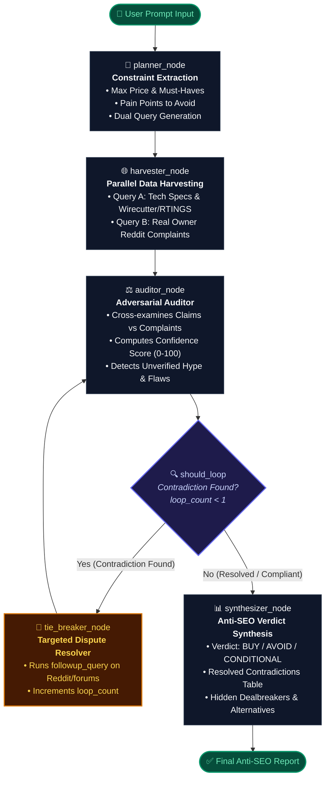
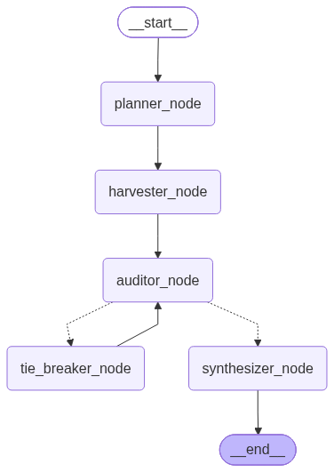

# 🛡️ TrueVerdict — Anti-SEO Product Scout & Contradiction Resolver

> **An Adversarial Multi-Agent Web Application** built with **LangGraph (Python + FastAPI)** and **Next.js (App Router + TypeScript + Tailwind CSS + Framer Motion)**.

Standard AI search engines summarize page-one sponsored affiliate blogs that bury long-term flaws. **TrueVerdict** runs an adversarial multi-agent pipeline that cross-examines marketing claims against 6-month Reddit failure modes and uses a cyclical tie-breaker loop to resolve product contradictions before you buy.

---

## 🔄 LangGraph Cyclical Architecture

Here is the multi-agent execution pipeline powered by LangGraph's cyclical `StateGraph`:



---

### Exported Graph Image
You can also view the direct compiled graph artifact generated from LangGraph:



---

## 🛠️ How to Export the Graph Image via Code

You can re-generate the graph diagram at any time using Python and LangGraph's built-in Mermaid export utilities:

### Option A: Generate PNG Image
```python
from backend.graph import graph_app

# Generates and saves the PNG flow chart
png_bytes = graph_app.get_graph().draw_mermaid_png()
with open("architecture_graph.png", "wb") as f:
    f.write(png_bytes)
print("Graph saved to architecture_graph.png")
```

### Option B: Print Mermaid Markdown String
```python
from backend.graph import graph_app

# Outputs the exact Mermaid syntax recognized by GitHub
print(graph_app.get_graph().draw_mermaid())
```

### Option C: Quick Terminal One-Liner
```bash
python -c "from backend.graph import graph_app; open('architecture_graph.png', 'wb').write(graph_app.get_graph().draw_mermaid_png())"
```

---

## ⚡ Quick Start

### 1. Clone & Set Up Backend (FastAPI + LangGraph)
```bash
# Clone the repository
git clone https://github.com/ShreyashF130/TrueVerdict.git
cd TrueVerdict

# Activate virtual environment
# Windows:
.\venv\Scripts\Activate.ps1
# Mac/Linux:
# source venv/bin/activate

# Install dependencies
pip install -r backend/requirements.txt

# Start backend server
uvicorn backend.main:app --host 127.0.0.1 --port 8000 --reload
```
*Backend runs on `http://127.0.0.1:8000` with live SSE streaming on `/api/investigate`.*

### 2. Set Up Frontend (Next.js 16 + Tailwind CSS + Framer Motion)
```bash
cd frontend
npm install
npm run dev
```
*Frontend opens at `http://localhost:3000`.*

---

## 📂 Project Structure

```text
TrueVerdict/
├── architecture_graph.png  # Generated LangGraph pipeline visual
├── backend/
│   ├── main.py             # FastAPI server with SSE streaming & CORS
│   ├── graph.py            # Cyclical StateGraph (5 nodes + should_loop edge)
│   ├── schemas.py          # Pydantic models for State, AuditResult, FinalVerdict
│   ├── search.py           # DuckDuckGo search + realistic fallback engine
│   ├── requirements.txt    # LangGraph, FastAPI, LangChain, DuckDuckGo
│   └── .env.example        # Optional Gemini / OpenAI keys
└── frontend/
    ├── src/app/
    │   ├── page.tsx        # Live StateGraph tracker & Verdict dashboard
    │   ├── layout.tsx      # Dark mode root layout
    │   └── globals.css     # Glassmorphic utilities
    ├── next.config.ts      # API rewrite proxy to backend
    └── package.json        # Next.js 16, Framer Motion, Lucide icons
```
